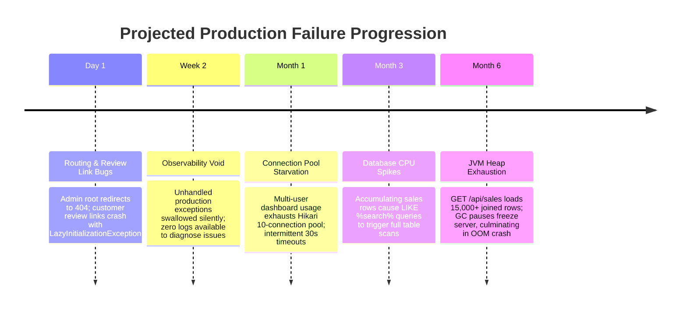
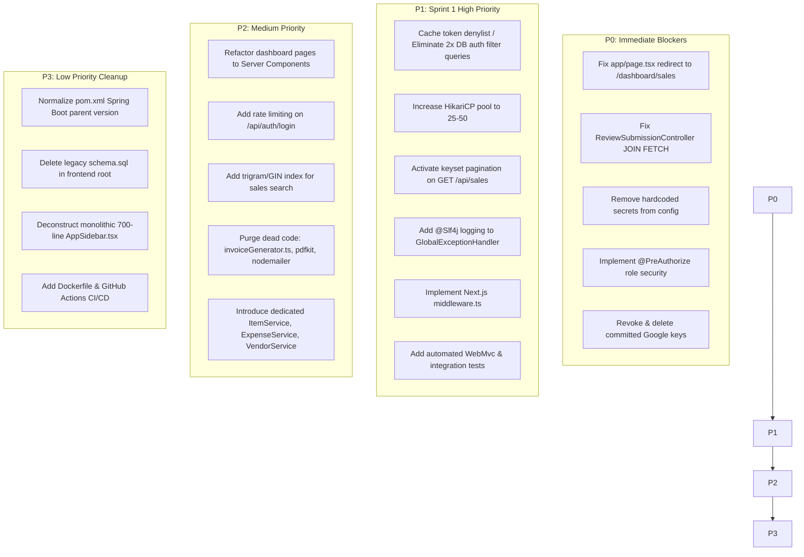

# Executive Production Readiness Report — Ficcado CRM

> **Document Type**: Executive Production Readiness & Architectural Assessment  
> **Scope**: Ficcado CRM (Backend: `backend/ficcado_crm_backend` & Frontend: `ficcado_crm_app`)  
> **Author Role**: Principal / Senior Software Engineer, Architect, Security Engineer, DevOps & SRE Reviewer  
> **Target Audience**: Engineering Leadership, Product Stakeholders, Production Reviewers  

---

## 1. Overall Rating Matrix

| Dimension | Score | Justification |
|---|---|---|
| **Overall Score** | **5.4 / 10** | A functional CRM with a solid relational data schema and modern UI, but hampered by critical security shortcuts, connection pool bottlenecks, and production-blocking routing/ORM bugs. |
| **Production Readiness** | **4.0 / 10** | **NOT Production Ready**. The application contains blocking bugs (root route 404, review page crash), hardcoded database passwords, and absent role authorization. |
| **Security** | **3.5 / 10** | Critical risks: plaintext secrets in configuration, absence of method-level role authorization (`@PreAuthorize`), and IDOR vulnerabilities on order/admin data. |
| **Backend Architecture** | **6.5 / 10** | Solid domain normalization (Flyway 27 tables, JPA enums, converters). Weakened by servlet filter database overhead and controllers directly bypassing services. |
| **Frontend Architecture** | **5.0 / 10** | Clean aesthetic and UI components, but operates as a 100% client-side SPA with zero Next.js `middleware.ts`, broken root routing, and dead code/dependencies. |
| **Database Design** | **7.5 / 10** | The strongest area. Migration from Google Sheets successfully created a clean, normalized relational schema with foreign keys, indexes, and transactional boundaries. |
| **Performance** | **4.5 / 10** | Unbounded list queries without pagination, in-memory array manipulation (`sales.reverse()`), and unindexed full-text `LIKE` searches. |
| **Scalability** | **3.5 / 10** | Severe architectural bottleneck: 2x synchronous database queries per HTTP request inside `JwtAuthenticationFilter` on a 10-connection Hikari pool will cause thread pool starvation under moderate concurrency. |
| **Maintainability** | **6.0 / 10** | Good enum registry and UI design tokens, but compromised by monolithic components (700-line sidebar), dead code (`invoiceGenerator.ts`), and conflicting legacy schemas. |
| **DevOps / Deployment** | **3.0 / 10** | Zero Dockerfiles, zero docker-compose configs, zero CI/CD pipelines, and no automated container build workflows. |
| **Observability** | **3.5 / 10** | `GlobalExceptionHandler` swallows unexpected 500 errors without logging, no request correlation IDs, no Prometheus metric export, no centralized logging. |

---

## 2. Overall Production Assessment

### 2.1 What the Application Does Well
1. **Relational Data Normalization**: The transition from unmaintainable Google Sheets spreadsheets to a normalized 27-table PostgreSQL schema is well executed. Child tables (`sale_line_items`, `item_sizes`, `customer_addresses`, `vendor_contact_numbers`) correctly model one-to-many relationships with foreign key integrity.
2. **Flyway Migration Discipline**: Schema evolution is managed entirely through versioned migrations (`ddl-auto: none`). This prevents dangerous runtime schema mutations by Hibernate.
3. **Enum Standardization**: Domain states (item status, sale status, payment mode, delivery status, refund reason) are centralized into 18 strongly-typed Java Enums with lenient auto-applied `AttributeConverter` classes that prevent database read crashes on legacy string variations.
4. **Cloudflare R2 Media Integration**: Product catalog images are cleanly offloaded to cloud object storage using the AWS SDK v2 S3 API rather than bloating the operational database.
5. **Per-Device Session Invalidation**: The SHA-256 token denylist architecture (`revoked_tokens`) provides authentic server-side logout invalidation without terminating sessions on an administrator's other concurrent devices.
6. **Cohesive Visual Design**: The frontend implements a polished, branded user interface with responsive side navigation, color-coded status badges, and animated brand loaders.

### 2.2 Critical Vulnerabilities & Systemic Weaknesses
1. **Broken Root Routing**: Authenticated administrators opening the root domain (`https://crm.ficcado.com/`) are greeted with an immediate **404 Not Found** because `app/page.tsx` redirects to non-existent `/sales` instead of `/dashboard/sales`.
2. **Public Review Page Crash**: Any customer clicking their email review link (`/review/{token}`) triggers an immediate HTTP 500 `LazyInitializationException` in `ReviewSubmissionController` because lazy Hibernate associations are accessed outside a transaction with `open-in-view: false`.
3. **Hardcoded Secrets & Fallbacks**: The repository contains live Google Service Account RSA private keys in plaintext (`.env.local`), a hardcoded fallback database password (`arjun7945`), and a static fallback JWT secret in `application.yaml`.
4. **Missing Method-Level Role Authorization**: Spring Security enforces authentication but completely lacks role-based authorization (`@PreAuthorize`). An authenticated warehouse handler can read full company financial reports (`/api/reports/profitability`), modify sales orders, and post expenses.
5. **Database Connection Pool Starvation**: `JwtAuthenticationFilter` executes two synchronous database queries (`isTokenRevoked` + `getAdminFromToken`) on **every single HTTP request**. Against HikariCP's default `maximum-pool-size: 10`, concurrent dashboard tab navigations will starve the pool and trigger `ConnectionTimeoutException`.
6. **Unbounded Queries & Missing Pagination**: Core list endpoints (`GET /api/sales`, `GET /api/items`) load entire tables into memory without database-level pagination, guaranteeing JVM heap exhaustion as transaction volume grows.
7. **Complete Absence of Automated Tests**: The backend contains only 1 scratch test printing hashes. Zero unit or integration tests exist to protect business logic, financial calculations, or authentication gates.
8. **Silent Error Swallowing**: `GlobalExceptionHandler` catches all unexpected server exceptions and returns generic JSON without logging stack traces, making production bugs impossible to diagnose from server logs.
9. **Dead Code & Phantom Dependencies**: Orphaned files (`lib/invoiceGenerator.ts`), fake email route stubs returning hardcoded JSON, duplicate spreadsheet libraries (`exceljs` + `xlsx`), and legacy backend libraries in the frontend (`bcryptjs`, `nodemailer`).

---

## 3. Live Production Behavior Assessment (Simulated Scale Analysis)

### 3.1 Low Traffic (10–100 Concurrent Users)
- **Expected Behavior**: Responsive UI with typical API latencies of 40–120ms. The application will function smoothly for basic sales logging and catalog browsing during initial rollout.
- **Immediate Breakdowns**:
  - Authenticated users hitting the root URL (`/`) will immediately report 404 errors.
  - Customers attempting to submit product reviews will encounter HTTP 500 errors.
  - Online presence indicators will flicker or fail across multi-pod serverless deployments.
  - SREs will have zero log context when random 500 errors occur.

### 3.2 Medium Traffic (500–1,000 Concurrent Users)
- **Expected Bottlenecks**:
  - **Hikari Connection Pool Collapse**: With 500 users active across tabs, the incoming request rate will exceed 100 requests/sec. Each request triggering 2 auth queries will cause instant pool exhaustion on Hikari's 10-connection limit. Request threads will block, hit the 30-second timeout, and throw `SQLTransientConnectionException`.
  - **Search Latency Spikes**: The search bar firing `LOWER(...) LIKE %...%` queries will force sequential full table scans, consuming 100% of PostgreSQL CPU.
  - **Memory Pressure**: `GET /api/sales` loading all historical orders into memory will increase JVM heap utilization and trigger frequent Garbage Collection pauses.

### 3.3 High Traffic (5,000–10,000 Concurrent Users)
- **System Breaking Points**:
  - **Cascading Server Outage**: Connection starvation will cascade from the database pool to Spring Boot's Tomcat request thread pool (default 200 threads). Once all threads are blocked waiting for database connections, Tomcat will reject new connections with `Connection Refused`.
  - **Denial of Service via CPU Exhaustion**: Attackers or automated bots targeting `/api/auth/login` without rate limiting will force hundreds of simultaneous BCrypt hashing operations, driving server CPU to 100%.
  - **JVM OutOfMemoryError (OOM)**: Simultaneous calls to `GET /api/sales` transferring thousands of entity graphs with line items will exceed JVM heap limits, crashing the container.

---

## 4. Future Failure Prediction & Technical Debt Trajectory

If deployed in its current state without remediation, the following failure sequence will unfold:

1. **Security Exposure**: Because role authorization is absent, an insider or compromised account will inevitably alter records or access confidential financial reports without detection.
2. **Maintenance Paralysis**: Because automated tests are nonexistent, developers will become fearful of modifying sales pricing or inventory deduction code due to unpredictable side effects.

---

## 5. Recommended Priority Remediation Roadmap

---

## 6. Final Senior Engineer Verdict

### 1. Is this application production-ready?
**No.** The application cannot be certified for production deployment in its current state.

### 2. If not, why?
It suffers from four immediate deployment-blocking deficiencies:
- Two critical functional bugs that break user entry (root URL 404) and public customer interaction (review link 500 error).
- Plaintext production secrets committed in configuration files.
- Absence of role-based authorization allowing privilege escalation.
- Severe connection pool starvation in the authentication filter that will cause instability under ordinary multi-user load.

### 3. What must be fixed before production?
1. Update `app/page.tsx` line 31 to redirect to `/dashboard/sales`.
2. Update `ReviewTokenRepository` and `ReviewSubmissionController` with eager `JOIN FETCH` queries to prevent `LazyInitializationException`.
3. Purge all hardcoded passwords, default JWT secrets, and committed Google service account private keys from `application.yaml` and `.env.*`.
4. Enable `@EnableMethodSecurity` in `SecurityConfig` and add `@PreAuthorize` guards on financial, administrative, and inventory endpoints.
5. Invalidate and cache the `JwtAuthenticationFilter` token denylist checks to eliminate synchronous per-request database overhead.

### 4. What can safely remain as-is?
- The 27-table PostgreSQL schema in `V1__create_schema.sql` (sound normalization and index foundations).
- Flyway migration strategy (`ddl-auto: none`).
- The 18 Java Enums and auto-applied JPA converters.
- The Cloudflare R2 / AWS S3 media storage integration.
- The UI styling, CSS design tokens, and SVG icon aesthetic.

### 5. What will become a problem when traffic increases?
- The 10-connection Hikari pool will cause frequent connection timeout errors.
- Unbounded `GET /api/sales` queries will exhaust server RAM and trigger JVM heap crashes.
- Leading-wildcard search queries will peg PostgreSQL CPU at 100%.

### 6. What are the largest security risks?
- Compromise of administrative credentials due to hardcoded fallback secrets.
- Horizontal and vertical privilege escalation via unauthenticated/unauthorized API manipulation (IDOR).
- Brute-force credential stuffing and CPU exhaustion on `/api/auth/login`.

### 7. What are the largest performance risks?
- Two blocking database queries on every authenticated request inside `JwtAuthenticationFilter`.
- Loading 10,000+ sales and line item entity graphs into memory on a single request.
- Sequentially fetching active items and warehouse allocations inside proxy route handlers.

### 8. What are the largest maintainability risks?
- Near-zero automated test coverage, making future code changes hazardous.
- Silent exception swallowing in `GlobalExceptionHandler`, leaving production incidents invisible to developers.
- Monolithic frontend components and dead legacy utilities confusing maintainers.

### 9. What are the largest architectural risks?
- Inconsistent layer boundaries (controllers directly querying repositories vs. using services).
- 100% client-side Next.js rendering bypassing Server Component streaming and relying on client `useEffect` hooks for authentication.
- Ephemeral in-memory presence tracking that fails in multi-pod deployments.

### 10. What should the development team prioritize first?
**Execute the P0 Roadmap immediately**:
1. Fix `app/page.tsx` route redirect (`/dashboard/sales`).
2. Fix `ReviewSubmissionController` lazy loading.
3. Externalize secrets and enforce `@PreAuthorize` method security.
4. Cache token denylist lookups to stabilize the database connection pool.
