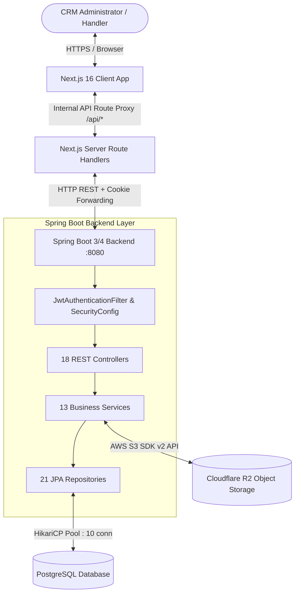
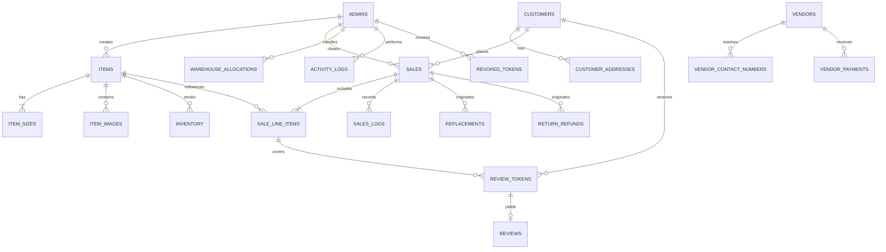

# Project Architecture and Overall Context Report — Ficcado CRM

> **Document Type**: Architecture & Overall System Context Report  
> **Target Scope**: CRM Frontend (`ficcado-inventory-sales-management-app`) & CRM Backend (`backend/ficcado-inventory-sales-management-app`)  
> **Status**: Comprehensive Analysis Completed  
> **Audience**: Principal Engineers, Software Architects, Security Engineers, DevOps Engineers, and Reviewers  

---

## 1. Application Overview

### 1.1 Purpose & Business Domain
**Ficcado** is an enterprise inventory, order fulfillment, and sales lifecycle management CRM designed for an apparel and lifestyle retail business. The system manages physical garment inventory, multi-channel sales logging, warehouse stock allocations across decentralized handlers, customer order fulfillment, item replacements, returns/refunds, damaged goods tracking, operational expense bookkeeping, vendor procurement ledgers, audit logging, and customer product review generation.

The codebase represents an active architectural migration from a legacy single-tier Google Sheets-backed Next.js web application to a modern relational architecture consisting of a **Spring Boot REST backend**, a **PostgreSQL relational database managed via Flyway migrations**, and a **Next.js 16 (React 19) frontend client**.

### 1.2 Major Modules & Bounded Contexts
The CRM system is organized into 16 primary operational modules:

1. **Items Management (`items`, `item_sizes`, `item_images`)**: Product catalog management defining item names, types, retail selling prices, cost prices, multi-size SKU variants (e.g., XS, S, M, L, XL, XXL), and media assets stored via Cloudflare R2 / S3-compatible object storage.
2. **Inventory Central (`inventory`)**: Master stock repository tracking SKU-level quantities available at central storage.
3. **Warehouse Allocations (`warehouse_allocations`)**: Decentralized stock distribution tracking quantities allocated to individual administrative field handlers and warehouse locations.
4. **Sales & Orders (`sales`, `sale_line_items`)**: Core transactional ledger tracking multi-item customer orders, unique invoice numbers (`FIC-...`), discount logic, delivery charges, customer association, payment statuses, fulfillment source selection (`TAKE_FROM_INVENTORY` vs. `WAREHOUSE_HANDLER`), and lifecycle states.
5. **Customer Directory (`customers`, `customer_addresses`)**: Normalized customer registry maintaining telephone numbers, names, email addresses, and shipping destinations updated idempotently upon sale creation.
6. **Replacements (`replacements`, `replacement_old_items`, `replacement_new_items`)**: Exchange workflow handling damaged, defective, or incorrectly sized items. Locks parent sale transactions during active processing.
7. **Returns & Refunds (`return_refunds`, `return_refund_items`)**: Post-delivery reverse logistics and monetary refund tracking. Locks parent sale transactions.
8. **Damaged Products (`damaged_products`)**: Defective stock write-offs recording defect classifications, item verification status, and physical disposition (`REPAIR`, `RETURN_TO_VENDOR`, `SCRAP`).
9. **Expenses Ledger (`expenses`)**: Operating expense ledger tracking overhead, logistics, packaging, and marketing outlays with categorized tax and payment metadata.
10. **Vendors & Procurement (`vendors`, `vendor_contact_numbers`, `vendor_payments`)**: Supplier registry tracking multi-contact vendor profiles and sequential payout installments.
11. **Profitability & Financial Reports (`reports/profitability`)**: Analytical aggregation engine computing Gross Revenue, Cost of Goods Sold (COGS), Gross Profit, Operating Expenses, and Net Profit across customizable date horizons.
12. **Audit & Activity Logs (`activity_logs`)**: System-wide administrative action trail recording actor ID, HTTP action, module tag, target entity key, and narrative summaries.
13. **Sales Transaction Logs (`sales_logs`)**: Dedicated event-sourced audit log capturing state transitions and financial updates for every individual invoice.
14. **Inventory History (`inventory_history`)**: Stock balance ledger capturing SKU adjustments, sales deductions, returns restocking, and manual corrections.
15. **Notes (`keep_notes`)**: Pinned scratchpad and administrative task list with color coding and priority indicators.
16. **Admin Access Control & Tokens (`admins`, `revoked_tokens`, `reviews`, `review_tokens`)**: Administrative user accounts, per-device JWT session revocation denylist, and tokenized post-delivery customer feedback links.

### 1.3 Major User Types & Personas
- **SUPERADMIN**: Master administrator. Has unrestricted access across all financial ledgers, system settings, admin account provisioning, deactivation, and data export.
- **ADMIN**: Operations manager. Full day-to-day access across sales, inventory, stock adjustments, customer orders, vendor transactions, and standard operational reports.
- **OPERATOR / HANDLER**: Warehouse and fulfillment personnel. Responsible for receiving allocated stock, physical dispatch, stock counts, and marking delivery updates.

---

## 2. Technology Stack

### 2.1 Backend Technology Matrix

| Aspect | Detail | Assessment / Notes |
|---|---|---|
| **Language & Runtime** | Java 21 (LTS) | Modern virtual thread capable runtime. |
| **Framework** | Spring Boot | Declared with `spring-boot-starter-parent: 4.1.1` in `pom.xml` (parent placeholder), utilizing Spring WebMvc, Spring Security, Spring Data JPA, Spring Validation, Spring Actuator, Spring Quartz, and Spring Mail. |
| **Data Persistence / ORM** | Spring Data JPA / Hibernate 6.x | Relational mapping, JPQL queries, Hibernate entity graphs. |
| **Database** | PostgreSQL | Managed via Flyway migrations (`V1__create_schema.sql`, `V2__seed_admin.sql`). |
| **Connection Pooling** | HikariCP | Configured with `maximum-pool-size: 10`, `minimum-idle: 2`, `connection-timeout: 30000ms`. |
| **Authentication** | JWT (JSON Web Token) | JJWT 0.12.6 with HS256 symmetric signing. Transmitted via httpOnly `ficcado_session` cookie. |
| **Authorization** | Stateless Filter + In-Memory Role Mapping | Minimal endpoint-level security rules; role checks performed manually in select service methods. |
| **Security Framework** | Spring Security 6.x | Stateless `SecurityFilterChain`, custom `JwtAuthenticationFilter`, custom `CorsConfigurationSource`. |
| **API Specification** | OpenAPI 3.0 / Swagger UI | `springdoc-openapi-starter-webmvc-ui` version 2.8.9 mounted at `/v3/api-docs` and `/swagger-ui.html`. |
| **External Integrations** | AWS SDK v2 S3 (Cloudflare R2) | `software.amazon.awssdk:s3` (2.26.29) configured for object storage of item media and thumbnails. |
| **Observability** | Spring Boot Actuator | Health endpoint exposed (`/actuator/health`). |
| **Background Processing**| Spring Quartz / `@Scheduled` | Hourly scheduled pruning of expired denylist tokens in `AuthService`. |

### 2.2 Frontend Technology Matrix

| Aspect | Detail | Assessment / Notes |
|---|---|---|
| **Framework** | Next.js 16.3.0 | Next.js App Router. |
| **Library Runtime** | React 19.2.8 / React DOM 19.2.8 | Latest React architecture. |
| **Language** | TypeScript 5.x | Strict typing enabled in `tsconfig.json`. |
| **Rendering Strategy** | 100% Client-Side (`'use client'`) | Every dashboard view is explicitly designated as a client component. |
| **State Management** | Local React Hooks (`useState`, `useEffect`) + SWR 2.5.0 | SWR used selectively; most components use raw `fetch()` in lifecycle hooks. |
| **Styling Solution** | Vanilla CSS + Tailwind CSS v4 | CSS variables in `app/globals.css` with Tailwind v4 PostCSS plugin. |
| **Data Communication** | Next.js API Routes (`app/api/**`) as Backend Proxy | Client fetches internal Next.js `/api/...` routes which forward requests to Spring Boot with forwarded cookies. |
| **Client Utilities** | `exceljs`, `xlsx`, `pdfkit`, `zod` | Client/server mixed utilities for document generation, schemas, and file exports. |

---

## 3. Architecture



### 3.1 Backend Architecture
The backend follows a classic **Layered Architectural Style (Controller $\rightarrow$ Service $\rightarrow$ Repository $\rightarrow$ Database)**:
- **Presentation Layer (`controller`)**: 18 `@RestController` classes exposing REST endpoints. DTOs are declared either as Java `record` types internal to the controllers or as standalone response objects.
- **Business Logic Layer (`service`)**: 13 `@Service` classes managing business rules, transactions (`@Transactional`), inventory deductions, cross-module synchronization, and auditing.
- **Data Access Layer (`repository`)**: 21 Spring Data `JpaRepository` interfaces with derived queries, custom `@Query` JPQL methods, and key-set pagination signatures.
- **Domain Model (`entity`)**: 27 JPA `@Entity` classes mapped to PostgreSQL tables, accompanied by 18 `enum` classes and 10 JPA `AttributeConverter` implementations.
- **Cross-Cutting Concerns (`security`, `config`, `exception`)**: Centralized RFC 9457 `GlobalExceptionHandler`, `JwtAuthenticationFilter`, and CORS configuration.

### 3.2 Frontend Architecture
The frontend is constructed on Next.js App Router using a **BFF (Backend-for-Frontend) Proxy Pattern**:
- **App Directory (`app/`)**: Route hierarchy separating public authentication (`(auth)/login`), entry routing (`page.tsx`), tokenized customer feedback (`review/[token]`), and authenticated operations (`(app)/dashboard/**`).
- **Proxy Route Handlers (`app/api/**`)**: 51 Next.js server route handlers intercepting client requests, extracting session cookies via `next/headers`, attaching cookie headers, and proxying HTTP requests to the Spring Boot backend (`http://localhost:8080`).
- **Components (`components/`)**: Shared presentation components (`AppSidebar`, `MobileHeader`, `LoadingGecko`, `NotificationBell`, `SessionTimeoutModal`, `ItemThumbnail`).
- **Client Libraries (`lib/`)**: Shared utilities (`apiClient.ts`, `enums.ts`, `validation.ts`, `dateUtils.ts`, `invoiceGenerator.ts`).

### 3.3 Database Architecture
The database schema consists of **27 relational tables** defined in a clean fresh-start Flyway script (`V1__create_schema.sql`):
- **Full Relational Normalization**: Comma-separated strings from the legacy architecture were normalized into discrete child tables:
  - `items` $\rightarrow$ `item_sizes` (`1:N`)
  - `items` $\rightarrow$ `item_images` (`1:N`)
  - `customers` $\rightarrow$ `customer_addresses` (`1:N`)
  - `sales` $\rightarrow$ `sale_line_items` (`1:N`)
  - `replacements` $\rightarrow$ `replacement_old_items` & `replacement_new_items` (`1:N`)
  - `return_refunds` $\rightarrow$ `return_refund_items` (`1:N`)
  - `vendors` $\rightarrow$ `vendor_contact_numbers` & `vendor_payments` (`1:N`)
- **Foreign Key Integrity**: Foreign keys enforce referential integrity with appropriate `ON DELETE RESTRICT`, `ON DELETE CASCADE`, or `ON DELETE SET NULL` cascades.
- **Indexing Strategy**: B-Tree indexes are defined across foreign key columns, status columns, unique constraints, and search keys.

### 3.4 API Architecture
- **Protocol**: Synchronous JSON-over-HTTP RESTful APIs.
- **Base URL**: Defaulted to `http://localhost:8080/api` (configurable via `NEXT_PUBLIC_API_URL`).
- **Error Standard**: Backend returns RFC 9457 Problem Details (`application/problem+json`) containing `type`, `title`, `status`, `detail`, and `timestamp`.

---

## 4. Folder Structure & Key Files

### 4.1 Backend Project Structure
```
backend/ficcado-inventory-sales-management-app/
├── pom.xml                                  → Maven build dependencies & plugins
├── src/main/resources/
│   ├── application.yaml                     → Datasource, Flyway, Hikari, JWT, R2, & Mail configuration
│   └── db/migration/
│       ├── V1__create_schema.sql            → 27 PostgreSQL DDL table definitions, indexes & constraints
│       └── V2__seed_admin.sql               → Default Superadmin initialization seed
└── src/main/java/com/aps/ficcado_inventory_sales_management_app/
    ├── FiccadoInventorySalesManagementAppApplication.java → Spring Boot application entry point
    ├── config/
    │   ├── JacksonConfig.java               → JavaTimeModule & serialization settings
    │   └── PasswordEncoderConfig.java       → BCryptPasswordEncoder bean definition
    ├── controller/                          → 18 REST API controllers
    │   ├── AdminController.java             → Admin CRUD and status management
    │   ├── AuthController.java              → Login, Logout, /api/auth/me, cookie generation
    │   ├── CustomerController.java          → Customer directory retrieval
    │   ├── DamagedProductController.java    → Damaged goods write-off logging
    │   ├── ExpenseController.java           → Expense tracking & summary
    │   ├── InventoryController.java         → Central stock management & manual adjustments
    │   ├── ItemController.java              → Catalog item management
    │   ├── ItemImageController.java         → Cloudflare R2 image upload/delete
    │   ├── KeepNoteController.java          → Internal notes & scratchpad
    │   ├── LogsController.java              → Activity, sales, & inventory audit log feeds
    │   ├── ReplacementController.java       → Item replacement lifecycle
    │   ├── ReportsController.java           → Profitability financial metrics
    │   ├── ReturnRefundController.java      → Return & refund processing
    │   ├── ReviewController.java            → Authenticated review listing
    │   ├── ReviewSubmissionController.java  → Public tokenized review submission
    │   ├── SaleController.java              → Sales order ingestion & lifecycle
    │   ├── VendorController.java            → Vendor registry & payout installments
    │   └── WarehouseController.java         → Handler stock allocation
    ├── converter/                           → 10 Auto-applied JPA AttributeConverter classes
    ├── entity/                              → 27 JPA entity classes
    │   └── enums/                           → 18 Business domain Enum definitions
    ├── exception/
    │   ├── BusinessRuleException.java       → Custom business violation exception
    │   ├── GlobalExceptionHandler.java      → @RestControllerAdvice RFC 9457 error handler
    │   └── SaleLockedException.java         → Locked order concurrency exception
    ├── repository/                          → 21 Spring Data JpaRepository interfaces
    ├── security/
    │   ├── JwtAuthenticationFilter.java     → Per-request JWT & denylist inspection filter
    │   └── SecurityConfig.java              → SecurityFilterChain & CORS configuration
    └── service/                             → 13 Business logic services
        ├── ActivityLogService.java          → Audit activity logging
        ├── AuthService.java                 → Auth credentials, JWT signing & denylist logic
        ├── CustomerService.java             → Customer upsert logic
        ├── DamagedProductService.java       → Damaged item logging & verification
        ├── InventoryService.java            → Stock adjustments & warehouse allocation logic
        ├── ItemImageService.java            → S3 thumbnail orchestration
        ├── MediaStorageService.java         → AWS SDK S3 client for Cloudflare R2
        ├── ProfitabilityService.java        → Revenue/COGS/Net Profit financial aggregations
        ├── ReplacementService.java          → Exchange item inventory adjustments
        ├── ReturnRefundService.java         → Reverse logistics processing
        ├── ReviewService.java               → Customer review token generation & submission
        ├── SaleService.java                 → Sale creation, locking, & status updates
        └── SalesLogService.java             → Order-level audit trail logging
```

### 4.2 Frontend Project Structure
```
ficcado-inventory-sales-management-app/
├── package.json                             → Next.js dependencies & scripts
├── next.config.ts                           → Next.js configuration (serverExternalPackages: ['pdfkit'])
├── tsconfig.json                            → TypeScript path aliases (@/*)
├── .env.local / .env.deploy                 → Public API base URL & deployment secrets
├── schema.sql                               → Legacy MySQL/Google Sheets reference schema
├── app/
│   ├── globals.css                          → CSS tokens, design variables & utility classes
│   ├── layout.tsx                           → Root HTML layout
│   ├── page.tsx                             → Root router redirecting authenticated users
│   ├── (auth)/
│   │   └── login/page.tsx                   → Admin email/password login screen
│   ├── (app)/dashboard/
│   │   ├── layout.tsx                       → Client dashboard shell (Sidebar, Header, Auth check)
│   │   ├── page.tsx                         → Master operational dashboard & KPI metrics
│   │   ├── sales/                           → Sales management list, new sale modal, invoice views
│   │   ├── items/                           → Product catalog list & image upload modal
│   │   ├── inventory/                       → Central stock adjustment tables
│   │   ├── warehouse/                       → Warehouse handler stock allocations
│   │   ├── replacement/                     → Replacement order tickets & status updates
│   │   ├── return-refund/                   → Return/refund claim tickets
│   │   ├── damaged-products/                → Defective goods ledger
│   │   ├── customers/                       → Customer contact registry
│   │   ├── expenses/                        → Expense logging & breakdown
│   │   ├── vendors/                         → Vendor directory & installment payments
│   │   ├── reports/profitability/           → Profitability breakdown & period selector
│   │   ├── activity/                        → System-wide activity logs
│   │   ├── sales-log/                       → Transactional sales audit trail
│   │   ├── inventory-history/               → SKU balance change history
│   │   ├── reconciliation/                  → Physical inventory count reconciliation
│   │   ├── announcements/                   → Administrative staff broadcasting
│   │   ├── notes/                           → Internal scratchpad notes
│   │   ├── admin/                           → Admin account management (Superadmin)
│   │   └── profile/                         → Admin self-profile & credential update
│   ├── api/                                 → 51 Next.js proxy route handlers
│   └── review/[token]/page.tsx              → Public tokenized customer review submission page
├── components/                              → Reusable React UI components
│   ├── AppSidebar.tsx                       → Collapsible grouped navigation sidebar
│   ├── ErrorMessage.tsx                     → Standard error dialog with retry handlers
│   ├── ItemThumbnail.tsx                    → Item image preview with on-brand fallback
│   ├── LoadingGecko.tsx                     → Animated SVG mascot brand loader
│   ├── MobileBackButton.tsx                 → Mobile viewport navigation button
│   ├── MobileHeader.tsx                     → Mobile top navigation bar & drawer
│   ├── NotificationBell.tsx                 → Admin alert bell dropdown
│   ├── SessionTimeoutModal.tsx              → Auto-logout idle warning dialog
│   └── StatusBadge.tsx                      → Color-coded domain status pill
└── lib/                                     → Shared utilities & helpers
    ├── apiClient.ts                         → Centralized fetch client with cookie forwarding
    ├── auth.ts                              → Legacy Next.js JWT helper (Google Service key based)
    ├── enums.ts                             → Centralized TypeScript Enums & exhaustive display labels
    ├── invoiceGenerator.ts                  → Server-side PDFKit invoice renderer
    ├── salesPricing.ts                      → Order total calculation utilities
    └── validation.ts                        → Zod validation schemas
```

---

## 5. End-to-End Data Flow

```
1. User Action in Browser
   │ Form submission in React client component (e.g. creating a new sale)
   ▼
2. Frontend Next.js API Proxy Handler
   │ Client fires fetch('/api/sales', { method: 'POST', body: payload })
   │ Handler in app/api/sales/route.ts reads incoming request cookies
   │ Injects cookies into apiClient.post('/api/sales', payload)
   ▼
3. HTTP Transport to Spring Boot Backend
   │ Network boundary: HTTP POST http://localhost:8080/api/sales
   │ Header: Cookie: ficcado_session=<jwt_token>
   ▼
4. Spring Security Filter Chain
   │ JwtAuthenticationFilter intercepts request
   │ Extracts 'ficcado_session' cookie value
   │ Queries PostgreSQL 'revoked_tokens' table to ensure token is not revoked
   │ Parses JWT claims, extracts admin ID
   │ Queries PostgreSQL 'admins' table to load Admin principal
   │ Injects UsernamePasswordAuthenticationToken into SecurityContextHolder
   ▼
5. Controller Request Handling
   │ SaleController.create() handles request
   │ Extracts @AuthenticationPrincipal Admin
   ▼
6. Business Service Execution
   │ SaleService.createSale(sale, admin) executes inside @Transactional
   │ Checks sale lock status
   │ Deducts inventory quantities (InventoryService)
   │ Upserts customer contact details (CustomerService)
   │ Persists Sale & cascades SaleLineItems (SaleRepository)
   │ Logs action to ActivityLogService & SalesLogService
   ▼
7. Database Transaction Commit
   │ PostgreSQL commits row changes atomically across tables
   ▼
8. Response Serialization & Client Render
   │ SaleResponse DTO returned as JSON
   │ Next.js route proxies response back to browser
   │ UI displays confirmation toast and refreshes sales table
```

---

## 6. Authentication Flow

```mermaid
sequenceDiagram
    autonumber
    actor Admin as Admin User
    participant Browser as React Frontend
    participant NextAPI as Next.js Proxy (/api/auth)
    participant AuthCtrl as Spring Boot AuthController
    participant AuthService as AuthService
    participant DB as PostgreSQL Database

    Admin->>Browser: Enters email & password
    Browser->>NextAPI: POST /api/auth/login { email, password }
    NextAPI->>AuthCtrl: POST :8080/api/auth/login
    AuthCtrl->>AuthService: authenticate(email, password)
    AuthService->>DB: findByEmailIdIgnoreCase(email)
    DB-->>AuthService: Admin record (password_hash)
    AuthService->>AuthService: passwordEncoder.matches(raw, hash)
    AuthService->>AuthService: generateToken(admin) [JJWT HS256]
    AuthService-->>AuthCtrl: JWT Token String
    AuthCtrl-->>NextAPI: 200 OK + Set-Cookie: ficcado_session=<JWT>; HttpOnly; SameSite
    NextAPI-->>Browser: 200 OK + Set-Cookie Forwarded
    Browser->>Browser: Redirects to /dashboard
```

### 6.1 Token Lifecycle Details
1. **Identifier Constraint**: CRM login strictly permits **email address only**. Any identifier without `@` is rejected immediately to eliminate username enumeration.
2. **Password Verification**: Passwords are verified against stored hashes using `BCryptPasswordEncoder`.
3. **Token Generation**: JJWT signs an HS256 token containing claims:
   - `sub`: Admin database ID (`Long`)
   - `email`: Admin email address
   - `role`: Admin role (`SUPERADMIN`, `ADMIN`)
   - `adminName`: Full display name
   - `iat`: Issue timestamp
   - `exp`: Expiration timestamp (default: 24 hours / 86,400,000 ms)
4. **Cookie Attributes**:
   - `Name`: `ficcado_session`
   - `HttpOnly`: `true` (inaccessible to client JavaScript)
   - `Path`: `/`
   - `Secure`: Dynamic (`true` if request is HTTPS)
   - `SameSite`: Dynamic (`None` in production HTTPS, `Lax` in local dev)
5. **Per-Device Logout & Revocation Denylist**:
   - On logout (`POST /api/auth/logout`), `AuthService.revokeToken()` computes the SHA-256 hash of the raw JWT and inserts it into the `revoked_tokens` table.
   - Any future request presenting this specific token string is rejected at `JwtAuthenticationFilter`.
   - Other concurrent sessions held by the same admin on different devices carry different tokens and remain valid.
   - An hourly `@Scheduled` task (`pruneExpiredRevokedTokens()`) deletes records where `expires_at < NOW()`.

---

## 7. Authorization Flow

### 7.1 Current Enforcement Model
- **Web Security Level**: In `SecurityConfig.java`, route authorization is configured with:
  ```java
  .authorizeHttpRequests(auth -> auth
      .requestMatchers(HttpMethod.OPTIONS, "/**").permitAll()
      .requestMatchers(HttpMethod.POST, "/api/auth/login").permitAll()
      .requestMatchers("/api/public/reviews/**").permitAll()
      .requestMatchers("/v3/api-docs/**", "/swagger-ui/**", "/swagger-ui.html", "/actuator/health").permitAll()
      .anyRequest().authenticated()
  )
  ```
  Every other endpoint requires an authenticated principal, but **no role-based authorization is enforced in `SecurityFilterChain`**.
- **Controller & Service Level**:
  - Role checks are implemented manually inside specific controller methods using `authService.hasRole(currentAdmin, AdminRole.SUPERADMIN)`:
    - `AdminController.create()` $\rightarrow$ SUPERADMIN only
    - `AdminController.update()` $\rightarrow$ SUPERADMIN or self
    - `AdminController.deactivate()` $\rightarrow$ SUPERADMIN only
  - **Absence of Role Checks on Core Operational Endpoints**: Controllers such as `SaleController`, `InventoryController`, `ExpenseController`, `VendorController`, `DamagedProductController`, and `LogsController` do not perform role checks. Any authenticated admin or field handler can invoke all operations.
- **Frontend Role Gating**:
  - The frontend inspects `admin.role` in `AppSidebar.tsx` to hide navigation links (e.g. hiding the "Admin" settings tab for non-Superadmins).

---

## 8. Database Design & Entity Architecture

The 27 PostgreSQL tables and their entity relationships are structured as follows:



### 8.1 Key Entity Mappings
1. **`admins`**: Primary user table with BCrypt hashed passwords, role enum, and active status flag.
2. **`items`**: Base catalog table with retail price, cost price, and denormalized `average_rating` and `review_count`.
3. **`item_sizes`**: Normalized sizes per item (`M`, `L`, `XL`, etc.) with `UNIQUE (item_id, size)`.
4. **`item_images`**: Media URLs stored in Cloudflare R2 with cover order index (`display_order = 1`).
5. **`inventory`**: Central stock quantity per item and size.
6. **`warehouse_allocations`**: Stock assigned to specific handlers and warehouse physical bins.
7. **`customers`**: Customer contact master record with partial unique index on non-null emails.
8. **`sales` & `sale_line_items`**: Financial orders storing monetary totals, invoice keys, customer links, delivery statuses, payment modes, and line item quantities.
9. **`replacements` & `return_refunds`**: Reverse logistics tables linking old items to newly dispatched items or refund settlements.
10. **`damaged_products`**: Quality assurance scrap and vendor return log.
11. **`expenses`**: General operational expenditures.
12. **`vendors` & `vendor_payments`**: Supplier master and installment disbursement log.
13. **`activity_logs`, `sales_logs`, `inventory_history`**: Audit logs with timestamps and narrative text.
14. **`revoked_tokens`**: SHA-256 hash denylist for invalidated sessions.
15. **`reviews` & `review_tokens`**: Customer review feedback loop.

---

## 9. Dependency Assessment

### 9.1 Backend Dependencies (`pom.xml`)
- **Core Starters**: `spring-boot-starter-webmvc`, `spring-boot-starter-data-jpa`, `spring-boot-starter-security`, `spring-boot-starter-validation`, `spring-boot-starter-actuator`, `spring-boot-starter-mail`, `spring-boot-starter-quartz`.  
  *Assessment*: Standard and appropriate.
- **Database**: `postgresql`, `flyway-core`, `flyway-database-postgresql`.  
  *Assessment*: Production standard for relational migration.
- **Documentation**: `springdoc-openapi-starter-webmvc-ui` (2.8.9).  
  *Assessment*: Clean OpenAPI 3 integration.
- **JWT**: `jjwt-api`, `jjwt-impl`, `jjwt-jackson` (0.12.6).  
  *Assessment*: Modern JJWT library using Java `SecretKey` cryptography.
- **Storage**: `software.amazon.awssdk:s3` (2.26.29).  
  *Assessment*: Used cleanly by `MediaStorageService` targeting Cloudflare R2 S3-compatible endpoints.
- **Boilerplate**: `org.projectlombok:lombok`.  
  *Assessment*: Reduces boilerplate getters/setters/builders.

### 9.2 Frontend Dependencies (`package.json`)
- **Core**: `next` (16.3.0), `react` (19.2.8), `react-dom` (19.2.8), `swr` (^2.5.0), `typescript` (^5), `tailwindcss` (^4).  
  *Assessment*: Modern React/Next.js foundation.
- **Redundant / Risky / Unused Flags**:
  1. **`exceljs` AND `xlsx`**: Both are installed concurrently in `package.json`. Two massive spreadsheet libraries serving overlapping purposes.
  2. **`nodemailer`**: Installed in frontend dependencies, but no SMTP logic runs in Next.js (email API routes are fake stubs returning hardcoded JSON).
  3. **`bcryptjs` & `jsonwebtoken`**: Backend authentication libraries installed in Next.js frontend dependencies despite authentication being delegated to Spring Boot.
  4. **`pdfkit` & `@types/pdfkit`**: Installed for `lib/invoiceGenerator.ts`, which is orphaned and never invoked.

---

## 10. Deployment, Infrastructure & DevOps

### 10.1 Environment Configuration
- **Backend Configuration**: Externalized in `src/main/resources/application.yaml` reading environment variables with local fallbacks (`DB_URL`, `DB_USERNAME`, `DB_PASSWORD`, `JWT_SECRET`, `CORS_ALLOWED_ORIGINS`, `R2_ACCOUNT_ID`, etc.).
- **Frontend Configuration**: Stored in `.env.local` and `.env.deploy` reading `NEXT_PUBLIC_API_URL` and `NEXT_PUBLIC_APP_URL`.

### 10.2 Identified Infrastructure Gaps
- **No Containerization**: Zero Dockerfiles or `docker-compose.yml` configurations exist in either the backend or frontend repositories.
- **No Automated CI/CD**: Zero pipeline definitions (`.github/workflows`, GitLab CI, Jenkinsfile) exist to enforce automated compilation, linting, unit testing, or artifact packaging prior to deployment.
- **Logging & Monitoring**: No centralized logging pipeline (e.g. ELK, Loki, Datadog) or Prometheus metrics scrapers are configured.

---

## 11. Architectural Strengths

1. **Clean Fresh-Start Relational Migration**: The migration from legacy Google Sheets successfully normalized messy comma-separated text columns into clean, strongly typed relational tables (`item_sizes`, `sale_line_items`, `vendor_contact_numbers`).
2. **Flyway Migration Discipline**: Schema evolution is owned entirely by Flyway (`ddl-auto: none`), eliminating hazardous automatic ORM schema mutations in production.
3. **Domain Enums & Auto-Applied Converters**: Dropdowns and entity states are governed by 18 Java Enums with auto-applied JPA `AttributeConverter` classes, preventing database read crashes on legacy string variations.
4. **Cloudflare R2 Object Storage**: Item image binaries are externalized to S3-compatible cloud storage rather than bloating the database or local file system.
5. **Per-Device Session Invalidation**: The token denylist architecture (`revoked_tokens` table with SHA-256 hashing) provides genuine server-side logout invalidation while preserving sessions across independent user devices.
6. **Consistent UI Design System**: The frontend features a cohesive aesthetic based on `DESIGN.md` tokens, custom SVG icons, and consistent loading states (`LoadingGecko`).

---

## 12. Primary Architectural Concerns

1. **Absence of Endpoint-Level Role Authorization**: Spring Security enforces authentication (`.anyRequest().authenticated()`), but lacks endpoint-level role authorization (`@PreAuthorize("hasRole('ADMIN')")`). Unprivileged users can call administrative and financial endpoints directly.
2. **Synchronous Database Overhead in Auth Filter**: Every HTTP request triggers two synchronous database queries inside `JwtAuthenticationFilter` (`isTokenRevoked` + `getAdminFromToken`), creating immediate thread and connection starvation against HikariCP's default pool of 10 connections.
3. **Unbounded Queries & Missing Pagination**: List endpoints (e.g., `GET /api/sales`, `GET /api/items`) load entire tables into memory without server-side pagination boundaries.
4. **100% Client-Side Next.js Rendering**: Every dashboard page is a client component (`'use client'`), which bypasses Server Component streaming and executes auth checks client-side via `useEffect` without Next.js `middleware.ts`.
5. **Committed Secrets & Hardcoded Fallbacks**: Plaintext Google service account private keys and default database credentials exist in configuration files.
6. **Dead Code & Orphaned Logic**: Legacy utilities (`invoiceGenerator.ts`), unused npm dependencies (`pdfkit`, `nodemailer`, `bcryptjs`), and mock email endpoints clutter the codebase.
7. **Zero Automated Test Coverage**: The backend contains only one scratch test printing BCrypt hashes, leaving business calculations and security rules without regression verification.
